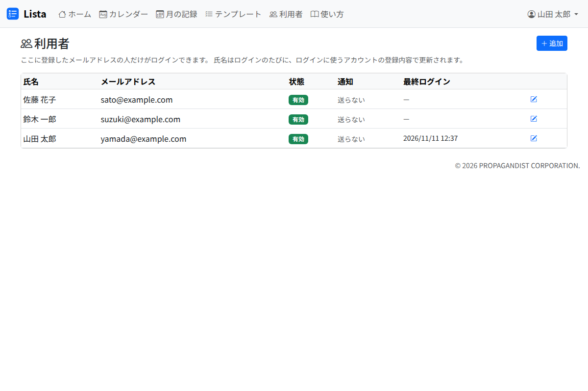

# 利用者の管理

「利用者」の画面に登録した人だけが、Lista にログインできます。

**Lista には役割（権限の差）がありません。** ログインできる人は誰でも、利用者の追加と無効化、テンプレートの変更を含めて、すべての操作ができます。

## 追加する

「追加」を押し、氏名とメールアドレスを入れて「保存」を押します。

- メールアドレスは、ログインに使うアカウントのものを入れます。大文字と小文字は区別しません
- 氏名は、その人がログインするたびに、ログインに使うアカウントの登録内容で書き換わります
- 追加したばかりの人は、通知を受け取らない設定です。本人が「自分の設定」で設定します（[通知の受け取り方](notifications.md)）

## 使わなくなった人

行の鉛筆で編集の画面を開き、「有効」をオフにして保存します。

- 無効にした人はログインできなくなり、担当の選択肢からも外れます
- 担当になっていたタスクは、担当のまま残ります（担当の欄に「（無効）」と出ます）
- 利用者の行は消せません。もう一度有効にすれば、元のとおり使えます
- 自分自身も無効にできてしまうので、気を付けてください

## 一覧の見方

| 列 | 中身 |
|---|---|
| 状態 | 有効・無効 |
| 通知 | IP メッセンジャーのユーザー名と「在席」「不在」、固定の通知先、ntfy。受け取らない人は「送らない」 |
| 最終ログイン | 最後にログインした日時 |

通知を受け取る人の行には「朝のまとめを今すぐ送る」が出ます。押すと、その人へ今の状況のまとめを送ります。
