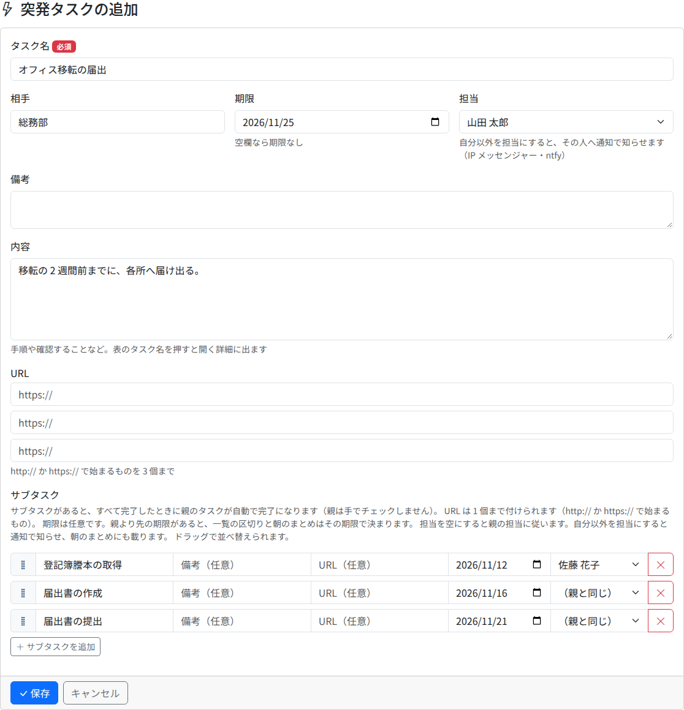

# 突発タスク

その都度入ってくる仕事は、突発タスクとして追加します。突発タスクは月に属さず、済むまでホームに残ります。済んだら、済んだ月の [月の記録](sheets.md) に残ります。

## 追加する

ホームの「突発を追加」を押し、欄を埋めて「保存」を押します。

| 欄 | 中身 |
|---|---|
| タスク名（必須） | 128 字まで |
| 相手 | 取引先や依頼元など。64 字まで |
| 期限 | 空なら期限なし。土日を選ぶと注意が出ます（ずらしはしません） |
| 担当 | 最初は自分。自分以外を選ぶと、その人へ通知で知らせます |
| 備考 | 表のタスク名の下に出る短い書き添え。512 字まで |
| 内容 | 手順や確かめることなど。詳細のダイアログに出ます。2000 字まで |
| URL | `http://` か `https://` で始まるものを 3 個まで |
| サブタスク | 下の「サブタスク」 |

### サブタスク

「サブタスクを追加」で行を足します。1 行に、名前・備考・URL（1 個）・期限・担当を入れられます。左端をつかんで並べ替えられ、右端の「×」で行を消します。名前が空の行は保存しません。

- サブタスクがあると、すべて済んだときに親のタスクが自動で完了になります。親は手でチェックしません
- サブタスクの期限は任意です。親より早い期限があると、ホームの区切りと朝のまとめはその期限で決まります
- 担当を空（「（親と同じ）」）にすると、親の担当に従います

## コピーして追加する

詳細のダイアログの「コピー」を押すと、そのタスクの内容を入れた追加画面が開きます。似た仕事を繰り返すときに使います。保存するまで何も作られず、元のタスクは変わりません。

- 定例タスクをコピーしても、突発タスクとして追加されます
- 期限は空になります（サブタスクの期限も外れます）
- メモと添付は写りません
- 担当が無効になった人なら、担当未定になります

## Outlook のメールから追加する

組織で Outlook のアドインを入れていれば、メールから突発タスクを追加できます。

1. Outlook でメールを開き、「Lista に追加」を押します
2. 作業ウィンドウの「Lista で開く」を押します。別のウィンドウで Lista の追加画面が開きます（ログインしていなければ、ログインの後に開きます）
3. タスク名と内容は AI が下書きします。相手には差出人の名前、URL 1 にはそのメールへのリンクが入ります。担当は自分、期限は空です
4. 中身を確かめて直し、「保存」を押します。**保存するまで、Lista には何も書かれません**

- **下書きのために、メールの件名・差出人の名前・受信日時・本文が Anthropic（米国）へ送られます。** 送ってよいメールかを確かめてから使ってください
- AI が使えないとき（組織で設定していない・応答が無いなど）は、件名と本文の先頭がそのまま入り、「AI で下書きを作れなかったので、件名と本文の先頭をそのまま入れました。…」と出ます
- アドインの入れ方は、組織の管理者に聞いてください
