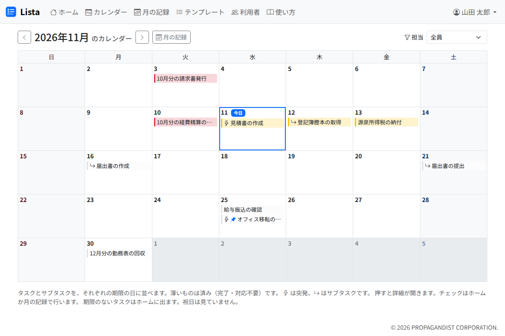

# カレンダー

カレンダーは、その月に期限があるタスクとサブタスクを、期限の日に並べて見る画面です。月の仕事の偏りや、週ごとの予定をつかむのに使います。

- 週は日曜日から始まります。今日には「今日」の印が付きます
- 項目を押すと、詳細のダイアログが開きます。**カレンダーではチェックできません。** チェックはホームか月の記録で行います
- 済んだもの（完了・対応不要）は、薄くして残します
- サブタスクは、矢印の印を付けて、サブタスクの期限の日に出ます。項目に重ねると「親のタスク名 ＞ サブタスク名」が出ます。突発タスクには稲妻の印、ピン止めしたタスクにはピンの印が付きます
- 上の「‹」「›」で前の月・次の月へ移ります。「月の記録」で、同じ月を表で開きます
- 担当の絞り込みは、ホームと共通です。サブタスクは、サブタスクの担当（空なら親の担当）で絞り込みます

載らないもの:

- 期限が無いタスク（ホームの「期限なし」に出ます）
- 月次シートを作っていない月の定例タスク（「（月）の定例はまだ作られていません。月の記録で作成できます。」と出ます）

祝日は見ていません。
