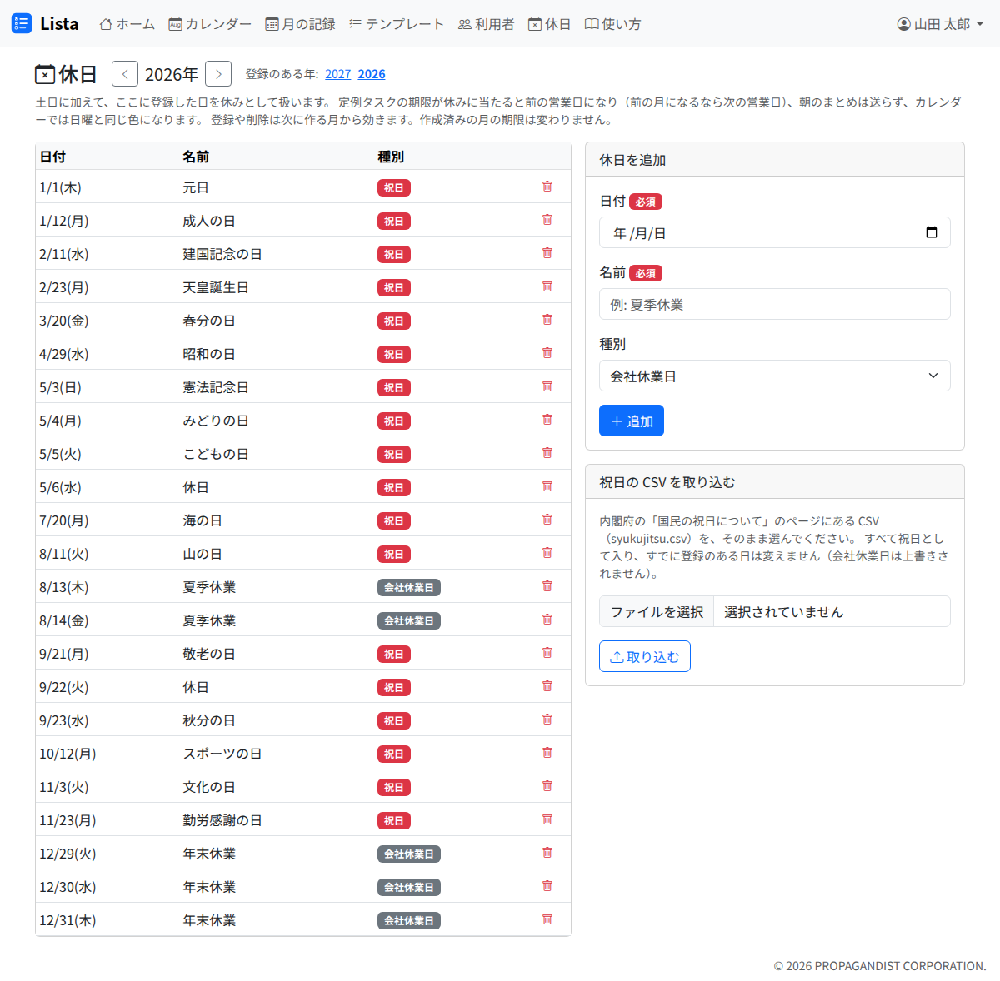

# 休日

「休日」の画面には、祝日と会社の休業日（夏季・年末年始など）を登録します。土日に加えて、ここに登録した日を休みとして扱います。

休みとして扱うところは次の 4 つです。

- **定例タスクの期限**: 休みに当たる月は、前の営業日になります。前の営業日が前の月になる場合は、次の営業日になります（[テンプレート](templates.md)）
- **朝のまとめ**: 休日には届きません。手で送るまとめは、休日にも送れます（[通知の受け取り方](notifications.md)）
- **カレンダー**: 休日は日曜日と同じ色になり、休日の名前が出ます（[カレンダー](calendar.md)）
- **タスクの期限の入力**: 休みの日を選ぶと注意が出ます。日付はずらしません（[突発タスク](adhoc.md)）

**登録や削除は、次に作られる月から効きます。** 作成済みの月の定例タスクの期限は変わりません。直したい期限は、タスクの編集で直してください。

## 祝日を取り込む

祝日は、内閣府が公開している CSV から取り込めます。

1. 内閣府の「国民の祝日について」のページから、CSV（`syukujitsu.csv`）を手元に保存します
2. 「休日」の画面の「祝日の CSV を取り込む」でそのファイルを選び、「取り込む」を押します

- 取り込んだ日は、すべて「祝日」として入ります
- **すでに登録のある日は変えません。** 会社休業日として登録した日が、祝日で上書きされることはありません
- 日付として読めない行があると、1 件も取り込まずに、その行の番号を出します
- 内閣府の CSV は、翌年の祝日が決まると更新されます。年に 1 回ほど取り込み直してください（同じ日は重ねて入りません）
- Lista のサーバーは、内閣府のページへ自分では取りに行きません

自分で作る CSV は、1 列目に日付（例: `2027/1/1`）、2 列目に名前を書きます。文字コードは UTF-8 か Shift_JIS です。

## 1 日ずつ登録する

画面の右の「休日を追加」で、日付・名前・種別（祝日・会社休業日）を入れて「追加」を押します。

- 同じ日は 1 件だけです。名前や種別を変えるときは、消してから登録し直してください
- 一覧の行のごみ箱で消せます
- 一覧は年ごとです。上の「‹」「›」か、「登録のある年」の数字で切り替えます
