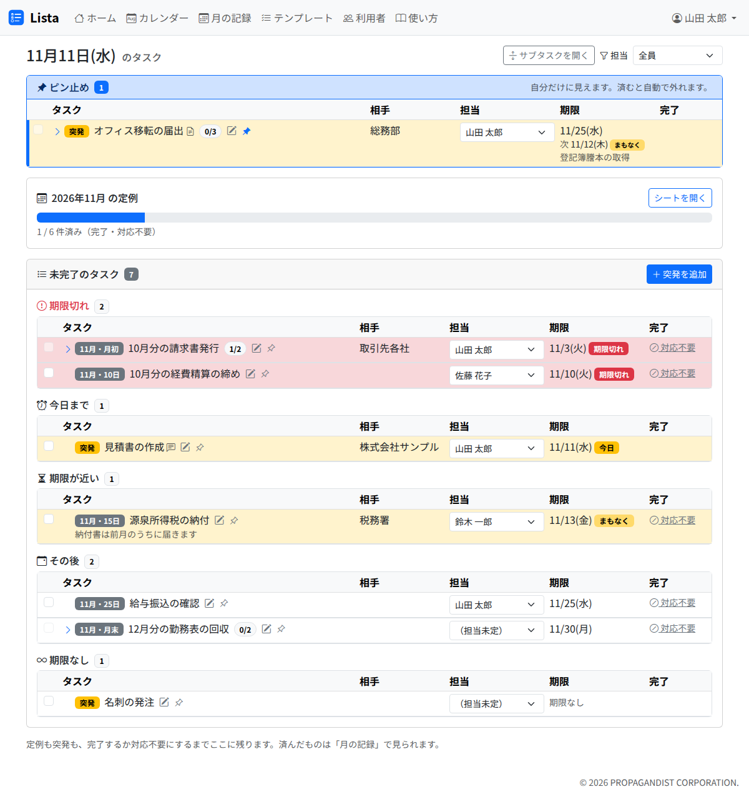

# ホーム

ホームは、済んでいないタスクの一覧です。定例（どの月のものでも）と突発を、期限の状況で区切って並べます。Lista を開いたら、まずここを見ます。

## 画面の上から

1. **ピン止め**: 自分がピン止めしたタスクです（下の「ピン止め」）。無ければ出ません
2. **今月の定例**: 今月の定例タスクの進み具合です。「シートを開く」で [月の記録](sheets.md) が開きます。今月のシートは、ホームを開いたときに無ければ作られます
3. **未完了のタスク**: 済んでいないタスクを、次の区切りで並べます。「突発を追加」で [突発タスク](adhoc.md) を追加できます

| 区切り | どのタスクか | 行の色・印 |
|---|---|---|
| 期限切れ | 期限を過ぎたもの | 赤。「期限切れ」 |
| 今日まで | 今日が期限のもの | 黄。「今日」 |
| 期限が近い | 期限が 2 日後までのもの | 黄。「まもなく」 |
| その後 | 期限が 3 日後以降のもの | 色なし |
| 期限なし | 期限が無いもの | 色なし |

- サブタスクに期限があるタスクは、**親の期限と、済んでいないサブタスクの期限のうち、早いほう**で区切ります。そのときは、期限の欄に「次 11/12(木) 登記簿謄本の取得」のように、次に来るサブタスクを添えます
- 定例タスクには「11月・月初」のように、月と区分の印が付きます。突発タスクには「突発」の印が付きます

## 行の見方

| 場所 | 中身 |
|---|---|
| 左端のチェック | 押すと完了になります（[タスクの操作](tasks.md)） |
| タスク名 | 押すと詳細が開きます |
| タスク名の右の印 | 内容・URL がある・添付がある・メモがある（印に重ねるとメモが読めます）・サブタスクの進み具合（済み / 全部） |
| 鉛筆 | 編集の画面を開きます（済んだタスクには出ません） |
| ピン | 自分のホームの一番上に留めます |
| 相手 | 取引先や依頼元など |
| 担当 | その場で担当を変えられます |
| 期限 | 期限と、区切りの印 |
| 完了 | 完了した日。日付に重ねると、誰がいつ完了したかが出ます。対応不要にしたものには「対応不要」の印が出ます（印に重ねると理由が出ます）。済んでいない定例タスクには「対応不要」のボタンが出ます |

## 担当で絞り込む

右上の「担当」で、表に出すタスクを選べます。選んだものは、ブラウザが覚えます（ホーム・月の記録・カレンダーで共通です）。

| 選ぶもの | 出るタスク |
|---|---|
| 自分と担当未定（最初の状態） | 自分が担当のもの、担当が空のもの、自分が担当のサブタスクを持つもの |
| 全員 | すべて |
| 担当未定だけ | 担当が空のもの |
| 人の名前 | その人が担当のもの（サブタスクの担当も含む） |

## サブタスクを開く・閉じる

サブタスクがあるタスクは、最初は閉じています。タスク名の左の「>」で開きます。右上の「サブタスクを開く」「サブタスクを閉じる」で、まとめて開け閉めできます。

## ピン止め

行のピンを押すと、そのタスクを自分のホームの一番上に留めます。急ぎのものや、気にかけておきたいものに使います。

- **ピン止めは自分にだけ見えます。** ほかの人のホームには出ません
- タスクが済むと、全員のピン止めが自動で外れます。チェックを外して戻しても、ピン止めは戻りません
- 済んだタスクはピン止めできません
- ピン止めした行には、左端に青い線が付きます。月の記録では並び順を変えず、この線だけが付きます
