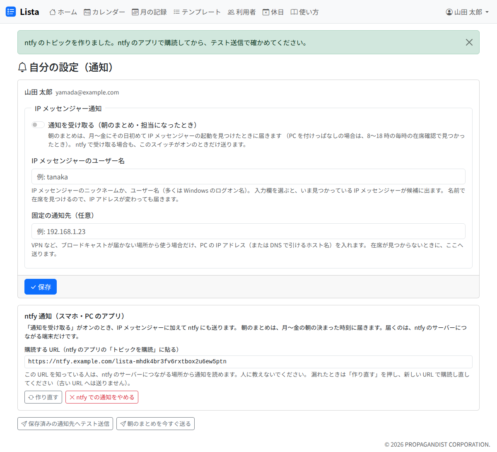

# 通知の受け取り方

Lista は、次の 2 つを知らせます。

| 通知 | いつ届くか | 中身 |
|---|---|---|
| 朝のまとめ | 月〜金の朝（下の「届くとき」） | 自分が担当の、済んでいないタスクのうち、期限切れ・今日が期限・3 日以内に期限のもの。担当未定のものも載ります |
| 担当の知らせ | ほかの人が、自分をタスクやサブタスクの担当にしたとき | 担当になったタスク・サブタスクと、担当にした人 |

届く先は、組織で使えるものによって、IP メッセンジャーと ntfy（スマートフォンや PC のアプリ）の 2 つがあります。設定は、右上の自分の名前 →「自分の設定（通知）」で行います。

## 通知を受け取る

1. 「通知を受け取る（朝のまとめ・担当になったとき）」をオンにします。**オフのあいだは、IP メッセンジャーにも ntfy にも送りません**
2. 受け取る先を登録します（下の 2 つの節。片方だけでもかまいません）
3. 「保存」を押します
4. 「保存済みの通知先へテスト送信」を押し、届くかを確かめます

## IP メッセンジャーで受け取る

- 「IP メッセンジャーのユーザー名」に、自分の IP メッセンジャーのニックネームかユーザー名（多くは Windows のログオン名）を入れます。入力欄を選ぶと、いま見つかっている IP メッセンジャーが候補に出ます
- Lista は名前で PC を探すので、IP アドレスが変わっても届きます
- VPN など、ほかの人の IP メッセンジャーが見えない場所から使うときは、「固定の通知先（任意）」に自分の PC の IP アドレスかホスト名を入れます
- IP メッセンジャーのメンバーの一覧には「Lista」と出ます。Lista に返信しても読まれません
- 「利用者」の画面で、自分が「在席」になっていれば、Lista から見えています

## ntfy で受け取る

組織で ntfy を用意していれば、「自分の設定」に「ntfy 通知（スマホ・PC のアプリ）」の枠が出ます。

1. 「ntfy で受け取る」を押します。購読する URL が出ます
2. スマートフォンや PC の ntfy アプリで「トピックを購読」を開き、その URL を貼ります（アプリで、サーバーに URL の前半を指定します）
3. 「保存済みの通知先へテスト送信」で届くかを確かめます

- **購読する URL を人に教えないでください。** URL を知っている人は、その通知を読めます。漏れたときは「作り直す」を押し、新しい URL で購読し直してください（古い URL へは送りません）
- やめるときは「ntfy での通知をやめる」を押します
- 通知を押すと Lista が開きます
- iPhone では、すぐには届かないことがあります（組織の設定によります）

## 届くとき

- **IP メッセンジャー**: 月〜金の 6 時以降に、その日初めて自分の IP メッセンジャーを Lista が見つけたときに届きます。PC を付けたままの人は、8〜18 時の毎時の在席の確認で見つかったときに届きます
- **ntfy**: 月〜金の 8 時 30 分に届きます。そのときに載せるものが無かった人には、18 時 30 分までの毎時 30 分に、載せるものができたときに届きます
- 朝のまとめは、届く先ごとに 1 日 1 通です。載せるものが無い日は届きません
- 担当の知らせは、そのときに IP メッセンジャーが見つからなければ（PC を閉じているなど）、IP メッセンジャーには届きません。期限が近ければ、次の朝のまとめに載ります
- [休日](holidays.md)（祝日・会社休業日）には送りません

## 手で送る

「朝のまとめを今すぐ送る」で、今の状況のまとめを自分へ送れます。朝に届いた後で状況が変わったときに使います。手で送っても、その日の自動のまとめは届きます。

## 届かないとき

「テスト送信」を押したときに出る文で、原因の見当が付きます。

| 出る文 | 見ること |
|---|---|
| 送り先が分かりません。… | IP メッセンジャーが起動しているか。ユーザー名の綴り |
| 通知を受け取らない設定なので送りません（…） | 「通知を受け取る」がオンか。受け取る先を登録したか |
| 通知先の名前を引けないか、ネットワークに問題があります。 | 固定の通知先の綴り |
| ntfy のサーバーに届かないか、トークンが違います。 | 組織の管理者に知らせてください |

テストは届くのに朝のまとめが来ないときは、載せるタスクが無い（自分の担当で、期限が 3 日以内のものが無い）ことがあります。
