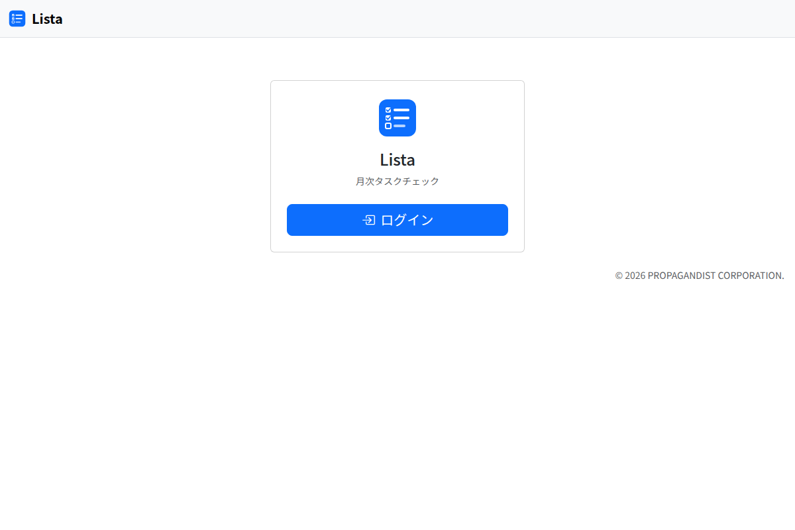

# Lista のあらまし

Lista は、チームの仕事を 1 つの一覧で管理する Web アプリです。毎月や毎年決まって行う仕事と、その都度入ってくる仕事を同じ一覧に並べ、期限が近いものから目立たせます。

## 2 種類のタスク

| 種類 | どんな仕事か | どう作られるか |
|---|---|---|
| **定例** | 毎月や毎年決まって行う仕事（請求書の発行、税金の納付など） | 「テンプレート」から、毎月 1 日に自動で作られます（年に 1 回の仕事は、その月だけ）。月ごとに記録が残ります |
| **突発** | その都度入ってくる仕事（見積書の作成、届出など） | 必要なときに、自分で追加します。Outlook のメールからも追加できます |

どちらも、**済む（完了するか、対応不要にする）までホームに残ります**。期限を過ぎても消えません。

## ログインする

Lista の URL を開き、「ログイン」を押します。組織のアカウントでサインインすると、ホームが開きます。

- ログインできるのは、「利用者」の画面に登録された人だけです。ログインできないときは、利用者を登録している人に頼んでください
- 操作が無いまま 3 時間たつと、ログインが切れます。画面に「ログインの有効期限が切れました。画面を読み込み直してください。」と出たら、画面を読み込み直してください

## 画面の構成

画面の上のメニューから、次の画面へ移ります。

| メニュー | できること |
|---|---|
| ホーム | 済んでいないタスクを、期限の近い順に見る。チェックする（[ホーム](home.md)） |
| カレンダー | その月に期限があるタスクを、日付の上に並べて見る（[カレンダー](calendar.md)） |
| 月の記録 | 月ごとの定例タスクの進み具合と、その月に済んだ突発タスクを見る。PDF で保存する（[月の記録](sheets.md)） |
| テンプレート | 定例タスクの元を登録する（[テンプレート](templates.md)） |
| 利用者 | Lista を使う人を登録する（[利用者の管理](accounts.md)） |
| 休日 | 祝日と会社の休業日を登録する（[休日](holidays.md)） |
| 使い方 | このガイドを開く |

右上の自分の名前を押すと、「自分の設定（通知）」と「ログアウト」が出ます（[通知の受け取り方](notifications.md)）。

## 言葉

| 言葉 | 意味 |
|---|---|
| 完了 | 仕事を済ませたこと。チェックを付けると完了になります |
| 対応不要 | その月は行わなくてよいこと。定例タスクにだけ付けられ、理由を残します（[タスクの操作](tasks.md)） |
| 済み | 完了と対応不要を合わせた呼び方です。進み具合は「済み」の数で数えます |
| サブタスク | タスクを小分けにした手順です。すべて済むと、元のタスク（親）が自動で完了になります |
| 担当 | そのタスクを受け持つ人です。空のときは「担当未定」と出ます |
| 朝のまとめ | 自分の担当で期限が近いタスクを、毎朝 IP メッセンジャーや ntfy で知らせるものです |
