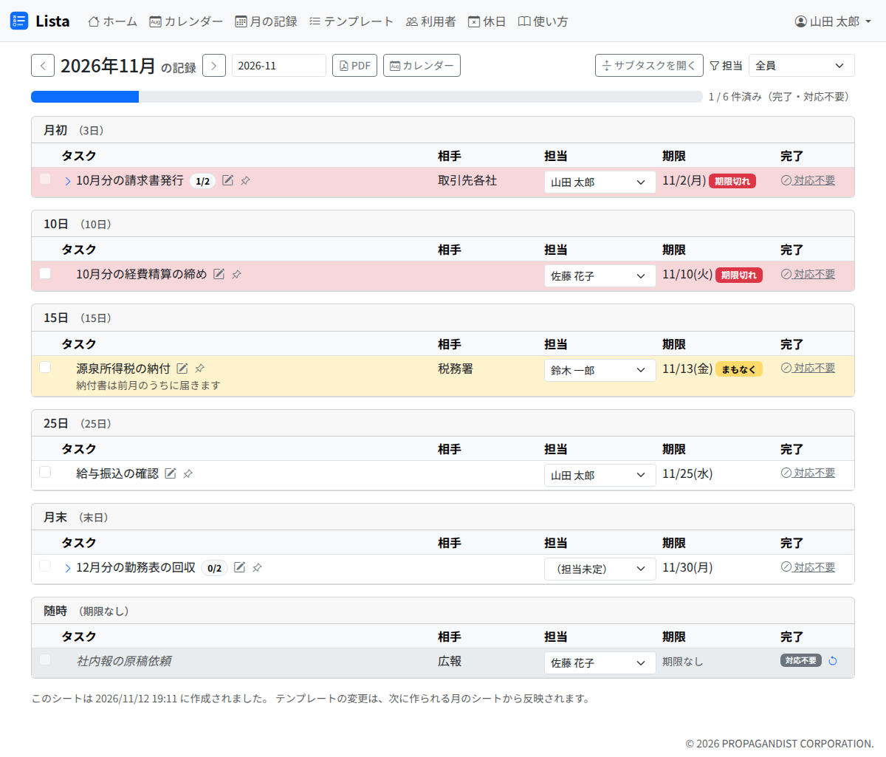

# 月の記録

月の記録は、月ごとの定例タスク（月次シート）と、その月に済んだ突発タスクの記録です。メニューの「月の記録」か、ホームの「シートを開く」で開きます。

## 見方

- 上の「‹」「›」で前の月・次の月へ、月の欄で好きな月へ移ります。「今月へ」で今月に戻ります
- 進み具合は「済み / 全部」で、完了と対応不要を合わせて数えます
- 定例タスクは、タイミングの区分ごと（「月初（3日）」など）に並びます。済んだものも消えずに残ります
- 下の「（月）に完了した突発」に、その月に完了した突発タスクが並びます
- チェック・対応不要・担当・メモは、ホームと同じように操作できます（[タスクの操作](tasks.md)）
- 「カレンダー」で、同じ月を [カレンダー](calendar.md) で開きます

## 月次シートが作られるとき

月次シートは、毎月 1 日に、その時点の有効なテンプレートのうち、その月に作るものから自動で作られます（[テンプレート](templates.md) の「作る月」）。

- 作られていない月を開くと、「この月のシートを作成」のボタンが出ます。押すと、その時点の有効なテンプレートのうち、その月に作るものからタスクが作られます
- 今月のシートは、ホーム・月の記録・カレンダーで今月を開いたときに、無ければ作られます
- **テンプレートを変えても、作成済みの月は変わりません。** 変更は次に作られる月から反映されます。作成済みの月に 1 件だけ足すときは、[テンプレート](templates.md) の「作成済みの月へ追加」を使います

## この月だけ編集する・削除する

済んでいない定例タスクは、行の鉛筆（「この月だけ編集」）で、その月の分だけ直せます。テンプレートと翌月以降のシートは変わりません。編集の画面の「削除」で、その月の分だけを消せます。削除したタスクは、シートを作り直しても戻りません。

## PDF で保存する

「PDF」を押すと、その月の記録を PDF（A4 横）でダウンロードします。月ごとの記録を残すときに使います。

- 載るのは、タスク名・相手・担当・期限・状態（完了・対応不要と理由・未完了）・メモです
- 内容・URL・添付は載りません
- 載せるものが無い月には、ボタンが出ません
