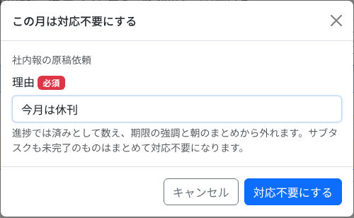
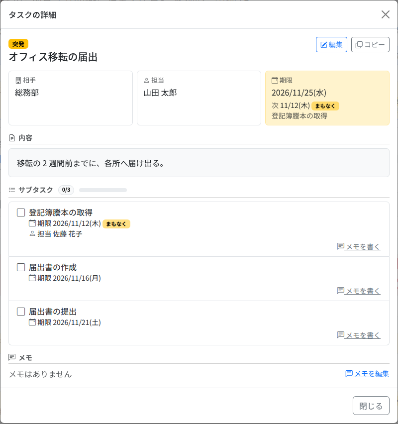

# タスクの操作

ホームと月の記録の表で行う操作です。チェック・担当・メモは、その場で保存されます（保存のボタンはありません）。

## 完了にする

行の左端のチェックを押すと、完了になります。完了の欄に、完了した日が出ます。誰が何時に完了したかは、日付に重ねるか、詳細で見られます。もう一度押すと、完了を取り消せます。

- **サブタスクがあるタスクは、手でチェックできません。** サブタスクをすべて済ませると、自動で完了になります。サブタスクのチェックを外すと、親も未完了に戻ります
- サブタスクは、名前を押してもチェックが切り替わります
- 完了したタスクはホームから消え、[月の記録](sheets.md) に残ります

## 対応不要にする（定例だけ）

その月は行わなくてよい定例タスクは、「対応不要」にします。完了の欄の「対応不要」を押し、理由を入れて「対応不要にする」を押します。

- 理由は必須です（256 字まで）。過去に使った理由が下に並び、押すと欄に入ります
- 対応不要にしたタスクは「済み」に数え、期限の強調と朝のまとめから外れます
- **親を対応不要にすると、済んでいないサブタスクもまとめて対応不要になります。** 完了したサブタスクがある親は、まとめて対応不要にできません。残りのサブタスクを 1 つずつ対応不要にしてください
- サブタスクがすべて対応不要になると、親も対応不要になります。1 つでも完了があれば、親は完了になります
- 取り消すときは、完了の欄の「対応不要」の印の右にある矢印を押します。理由と、誰がいつ対応不要にしたかは、印に重ねるか、詳細で見られます
- 突発タスクは対応不要にできません。不要になったら削除してください

## 詳細を見る

タスク名を押すと、詳細のダイアログが開きます。相手・担当・期限・内容・リンク・添付・サブタスク・備考・メモをまとめて見られます。

- 「編集」（定例は「この月だけ編集」）で編集の画面を開きます。済んだタスクには出ません
- 「コピー」で、このタスクの内容を入れた突発タスクの追加画面を開きます（[突発タスク](adhoc.md)）
- 詳細の中ではチェックできません。チェックは表で行います

## メモを残す

メモは、進み具合や申し送りを書き残す欄です。詳細のダイアログの「メモを編集」（サブタスクは「メモを書く」）で書き、「保存」を押します。1024 字まで書けます。

- メモは、済んだタスクにも書けます
- メモがあるタスクは、表のタスク名の右に印が出ます。印に重ねると本文が読めます

## 担当を変える

表の「担当」の欄で、その場で変えられます。選べるのは、有効な利用者です。「（担当未定）」にすると、担当が空になります。

- 自分以外を担当にすると、その人へ通知で知らせます（[通知の受け取り方](notifications.md)）
- サブタスクにも担当を付けられます（編集の画面で）。サブタスクの担当が空なら、親の担当に従います

## 編集する・削除する

行の鉛筆か、詳細の「編集」で、編集の画面を開きます。入力の欄は [突発タスク](adhoc.md) の追加と同じです。

- **完了・対応不要のタスクは、編集も削除もできません。** 直すときは、先にチェックを外すか、対応不要を取り消してください
- 定例タスクの編集は「この月だけ」です。テンプレートと翌月以降のシートは変わりません（変えるときは [テンプレート](templates.md) を直します）
- 削除は、編集の画面の下の「削除」で行います。サブタスク・メモ・添付も消え、元に戻せません。定例タスクを削除しても、テンプレートは変わりません

## ファイルを添付する

編集の画面の「添付」で、ファイルを選んで「添付する」を押します。

- 1 ファイル 10 MB までです
- 保存のボタンを押さなくても、添付はすぐに残ります。削除もすぐに反映されます
- 完了・対応不要にすると、添付は見るだけになります（詳細のダイアログからダウンロードできます）
- 添付は親のタスクにだけ付けられます。コピーしても引き継ぎません
