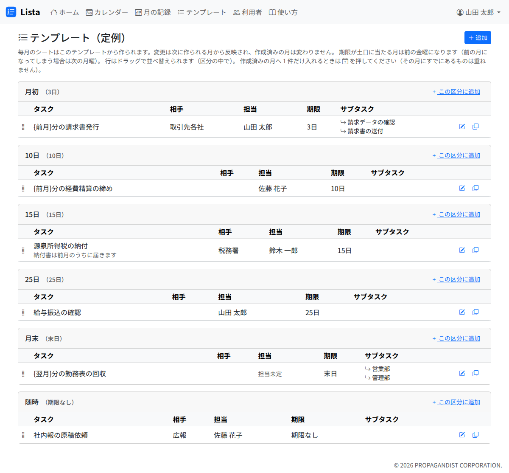
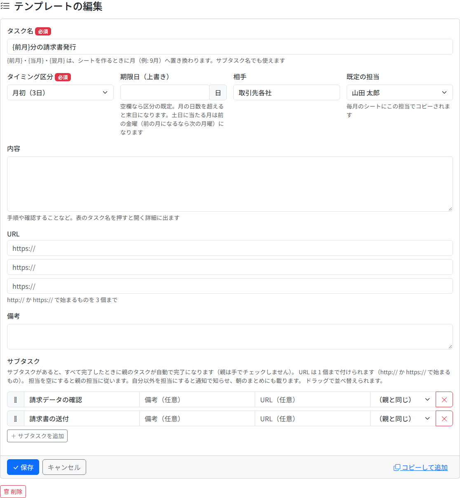

# テンプレート

テンプレートは、毎月の定例タスクの元です。毎月 1 日に、有効なテンプレートから、その月の定例タスク（月次シート）が作られます。

## 一覧の見方

- テンプレートは、タイミングの区分ごとに並びます。行をつかんで、区分の中で並べ替えられます。並びは月次シートの並びになります
- 「追加」か、区分の見出しの「この区分に追加」で、新しいテンプレートを作ります
- 行の右の印から、編集・コピーして追加・作成済みの月へ追加ができます
- 担当の欄の「担当者が無効」は、既定の担当が無効になった人であることを示します。直しておかないと、毎月のタスクは担当未定で作られます

## 追加する・編集する

| 欄 | 中身 |
|---|---|
| タスク名（必須） | 128 字まで。下の「月の差し込み」が使えます |
| タイミング区分（必須） | 月初（3日）・5日・10日・15日・20日・25日・月末（末日）・随時（期限なし） |
| 期限日（上書き） | 区分の既定の日を変えるとき（1〜31）。月の日数を超えると末日になります |
| 相手 | 取引先や依頼元など |
| 既定の担当 | 毎月のタスクに、この担当が写ります |
| 内容・URL・備考 | タスクと同じ（[突発タスク](adhoc.md)） |
| サブタスク | タスクと同じ。ただし期限は持てません |

- **期限が土日に当たる月は、前の金曜日になります。** 前の金曜日が前の月になる場合は、次の月曜日になります。祝日は見ません
- **変更は、次に作られる月から反映されます。** 作成済みの月は変わりません
- 「コピーして追加」で、内容を入れた追加画面が開きます。保存するまで何も作られず、元のテンプレートは変わりません

### 月の差し込み

タスク名とサブタスク名に `{前月}` `{当月}` `{翌月}` と書くと、月次シートを作るときに月（例: `9月`）へ置き換わります。

| テンプレートのタスク名 | 11 月のシートでのタスク名 |
|---|---|
| `{前月}分の請求書発行` | 10月分の請求書発行 |
| `{翌月}分の勤務表の回収` | 12月分の勤務表の回収 |

## 作成済みの月へ追加する

テンプレートを足しても、作成済みの月には入りません。今月から使いたいときは、行の「作成済みの月へ追加」を押し、追加する月を選んで「追加」を押します。

- 選べるのは、シートを作成済みの月だけです。未作成の月は、シートを作ればすべてのテンプレートが入ります
- その月に同じテンプレートのタスクがすでにあれば、追加しません

## 削除する

編集の画面の下の「削除」で消します。次に作られる月から、このタスクは作られなくなります。作成済みの月のタスクは残ります。
